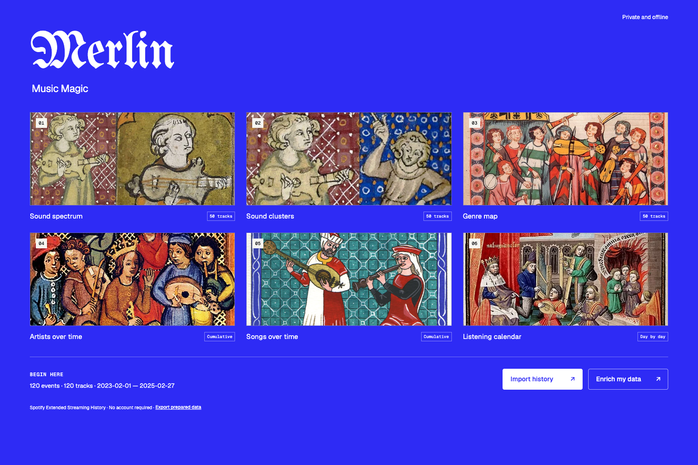

# Merlin

Music Magic. A browser-first explorer for Spotify listening history.

## For people using the app

Open the hosted app, choose **Import history**, and select your Spotify Extended Streaming History JSON files. Merlin combines them on your device. You do not need GitHub, an account, Python, or an LLM to use the standard views.

The app has six views:

- **Sound spectrum** — a continuous audio-similarity axis.
- **Sound clusters** — similar-sounding tracks in separate lanes.
- **Genre map** — the available track-level genre families.
- **Artists over time** — selectable top-50 cumulative listens or recorded minutes.
- **Songs over time** — the same comparison for individual Spotify track IDs.
- **Listening calendar** — daily listening across the selected dates.

Artist, song, and calendar views work directly from history. Sound and genre views require their respective optional enrichment. Missing and partial coverage is shown explicitly.

Export your prepared data before closing or refreshing the app. You can import that one file next time instead of repeating the original conversion.

## Privacy

Imported listening data is processed in a browser worker and retained in tab memory. It is not sent to Netlify, GitHub, a backend, or analytics. The offline cache contains application assets only, not imported history. Original IP fields are discarded from prepared data. This repository contains no personal listening-history files, private fixtures, provider response caches, credentials, or real-history screenshots.

Optional enrichment runs separately on a user's computer and contacts metadata providers only when the user authorizes that workflow. The catalog export contains track identifiers/names, artists, and albums—not listening timestamps or source IP addresses. API keys belong in a secure local environment, never in the website, chat, Git, or imported files.

## Deploy on Netlify

This repository includes the ready-built static website.

1. In Netlify, choose to import an existing Git repository and select this repository.
2. Leave the build command empty.
3. Use `site` as the publish directory. The included `netlify.toml` also declares it.
4. Deploy. Share the resulting Netlify URL with visitors; they never need to use GitHub.

Only publish `site/`, not private data folders or your entire local workspace. If modifying the renderer source, run `python3 build.py` and commit its generated files before deploying. No paid service or database is required for the base app.

## Optional enrichment

The **Enrich my data** dialog contains a copyable prompt, a downloadable kit, a catalog export, and an enrichment-file import.

The recommended sources have separate purposes:

- **stats.fm:** numeric audio features for Sound spectrum and Sound clusters, where access/terms permit.
- **Last.fm track.getTopTags:** track-level genre evidence for Genre map. Many legitimate/popular songs return no usable tags; unknowns must remain unknown.

A completed request is not necessarily usable enrichment. The importer reports matched IDs, complete audio records, usable genre families, coverage, and newly available views. Incremental imports preserve previous data when new fields are null or omitted.

The kit uses cached, checkpointed requests, up-to-50-ID audio batches, configurable provider-specific start intervals, and stop/cooldown handling for limits. The defaults are local pacing choices, not a guarantee of provider quotas or continued public access. No external metadata collection or paid model classification runs automatically in the browser. See [the kit instructions](enrichment-kit/README.md).

## Run and develop locally

Serve the static site rather than opening it as `file://`:

    python3 -m http.server 8776 --bind 127.0.0.1 --directory site

Open http://127.0.0.1:8776/.

The source is plain HTML/CSS/JavaScript, with a Python-standard-library renderer/kit build:

    python3 build.py

`renderer/`, `calendar.js`, `chart-ui.js`, and the chart styles generate `site/chart-frame.html`, a data-free renderer. User data is inserted into its in-memory frame only after import. `site/data-core.js` owns conversion, validation, additive enrichment and local models.

### Tests

Node 20+ and Python 3.10+ are recommended for development. Data/collector tests use no live provider requests:

    node tests/test-data.js
    node tests/test-enrichment-merge.js
    python3 tests/test-enrichment.py
    python3 tests/test-pacing.py

For browser tests:

    python3 -m pip install -r requirements-dev.txt
    python3 -m playwright install chromium
    python3 tests/test-browser.py
    python3 tests/test-review.py

Alternatively, set `MERLIN_CHROME_PATH` to an installed Chrome executable. The public tests use clearly labeled synthetic fixtures. Personal full-history tests and data are not distributed.

## Counting and model notes

- Audio-track events only. Podcasts, audiobooks and video are outside these views.
- Exact duplicates are compared using full original records within the inferred medium. Distinct editions and non-identical events are not fuzzy-merged.
- Dates use UTC stream-end timestamps. The UI's Dates label does not infer historical local time zones.
- The default 30-second threshold is an analytical choice, not an official Spotify-counted stream or a full-song-completion claim.
- Recorded minutes sum original milliseconds; they are not guaranteed non-overlapping wall-clock time.
- Cumulative lines retain earlier totals under date zoom. Rankings use the archive after explicit duration/genre filters; search narrows the chooser.
- Audio models use eight standardized/clipped features, a leading projection, and deterministic k-means. A one-dimensional projection loses information; audio-derived cluster descriptions are not known genres.
- Genre coordinates are stable alphabetical reference positions, not a universal musical-distance taxonomy. Multi-family tags overlap, and sparse tag coverage can bias the view.
- Missing data is never zero-filled or replaced with invented genres. The archive endpoint is not a live Spotify feed.

## Design and notices

Merlin uses the supplied Meridian design system: ultramarine, paper neutrals, Geist/Geist Mono, and a manuscript-inspired wordmark/gallery. Fonts are self-hosted; their OFL notices are included in `site/assets/`.

No application software license has been selected. Illustrative artwork and provider data terms should be reviewed separately before reuse; the font notices do not license unrelated artwork or metadata.
